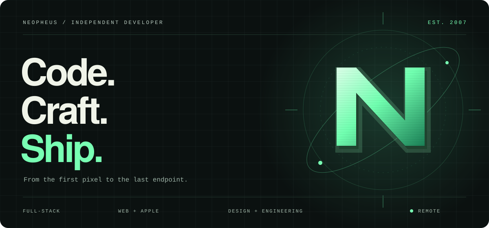
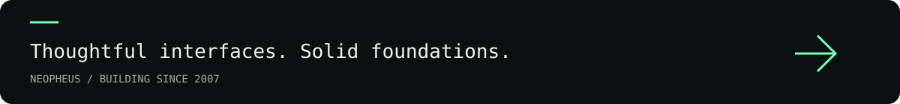

  

<h1 align="center">Engineering meets imagination.</h1>

  Freelance full-stack developer working remotely since <strong>2007</strong>. 
  I turn complex ideas into web applications, visual tools and native Apple experiences.

  <a href="https://github.com/neopheus?tab=repositories"><strong>Explore my code ↗</strong></a>
  &nbsp; / &nbsp;
  <a href="https://github.com/neopheus?tab=overview">Follow the build ↗</a>

 

<table>
<tr>
<td width="33%" valign="top"><h3>01 / Web & commerce</h3>
Business applications, APIs, payments and the workflows behind them.
</td>
<td width="33%" valign="top"><h3>02 / Pixels & precision</h3>
Interactive configurators, canvas graphics, 3D and print-ready output.
</td>
<td width="33%" valign="top"><h3>03 / Native experiences</h3>
Apple apps with thoughtful interfaces and playful interactions.
</td>
</tr>
</table>

 

## The toolkit

From interface to infrastructure. The technologies I work with.

<table>
<tr>
<td width="50%" valign="top">
<h3>01 / Frontend</h3>

 &nbsp;
 &nbsp;
 &nbsp;
 &nbsp;
 &nbsp;
 &nbsp;
 &nbsp;
 &nbsp;
 &nbsp;
 &nbsp;
 &nbsp;
 &nbsp;

<strong>HTML5 · CSS3 · JavaScript · TypeScript · Vue.js · React · Pinia · Vuetify · Tailwind CSS · Bootstrap · Sass · jQuery</strong>

State management with Pinia and Zustand · Inertia.js · Responsive interfaces

</td>
<td width="50%" valign="top">
<h3>02 / Backend & APIs</h3>

 &nbsp;
 &nbsp;
 &nbsp;
 &nbsp;
 &nbsp;

<strong>PHP · Laravel · Node.js · GraphQL · Strapi</strong>

REST APIs · WebSockets · Laravel Horizon, queues and background jobs · Payment integrations with Stripe

</td>
</tr>
<tr>
<td width="50%" valign="top">
<h3>03 / Apple & desktop</h3>

 &nbsp;
 &nbsp;
 &nbsp;

<strong>Swift · Xcode · Electron</strong>

SwiftUI · SceneKit · IOKit · Native iOS and macOS development

</td>
<td width="50%" valign="top">
<h3>04 / Graphics & data visualization</h3>

 &nbsp;
 &nbsp;
 &nbsp;
 &nbsp;

<strong>Three.js · OpenCV · Chart.js · D3.js</strong>

Fabric.js · Canvas · SVG · WebGL · Image processing · PDF generation and print workflows

</td>
</tr>
<tr>
<td width="50%" valign="top">
<h3>05 / Databases & services</h3>

 &nbsp;
 &nbsp;
 &nbsp;
 &nbsp;
 &nbsp;

<strong>PostgreSQL · Maria DB · MongoDB · Redis · Supabase</strong>

Relational and document databases · Caching · Typesense search

</td>
<td width="50%" valign="top">
<h3>06 / Infrastructure & delivery</h3>

 &nbsp;
 &nbsp;
 &nbsp;
 &nbsp;
 &nbsp;
 &nbsp;
 &nbsp;
 &nbsp;
 &nbsp;
 &nbsp;
 &nbsp;
 &nbsp;

<strong>Docker · Kubernetes · Linux · Nginx · AWS · GCP · Vercel · Cloudflare · Git · GitLab · GitHub Actions · Bash</strong>

Cloud infrastructure · CI/CD · Deployment automation

</td>
</tr>
<tr>
<td width="50%" valign="top">
<h3>07 / Build, testing & monitoring</h3>

 &nbsp;
 &nbsp;
 &nbsp;
 &nbsp;
 &nbsp;
 &nbsp;

<strong>Vite · Webpack · Vitest · Playwright · ESLint · Sentry</strong>

Unit and browser testing · Vue Test Utils · Prettier · Lighthouse · Error monitoring

</td>
<td width="50%" valign="top">
<h3>08 / Design</h3>

 &nbsp;
 &nbsp;
 &nbsp;
 &nbsp;

<strong>Figma · Illustrator · Photoshop · Adobe XD</strong>

Interface design · Vector graphics · Image editing

</td>
</tr>
</table>

 

GitHub trophies & profile views

